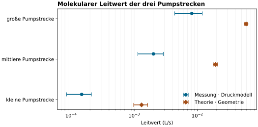
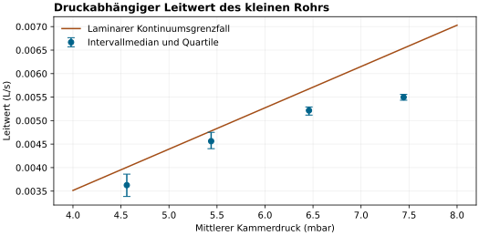
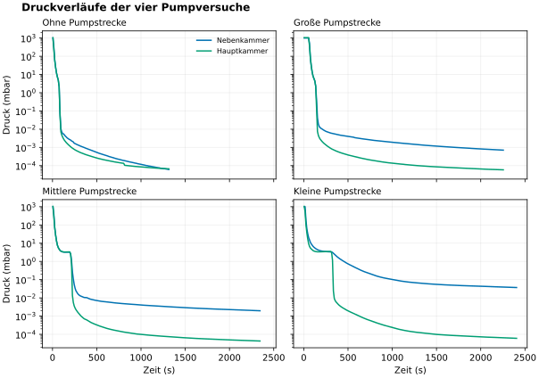
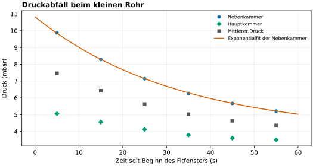
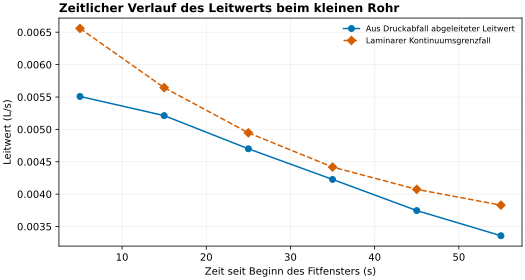

# Differentielles Pumpen

Auswertung eines Versuchs im Fortgeschrittenenpraktikum Physik der Heinrich-Heine-Universität Düsseldorf. Zwei Vakuumkammern sind über wechselbare Durchlassrohre gekoppelt. Die Auswertung vergleicht die experimentellen Leitwerte mit Modellen für molekulare Strömung und den laminaren Kontinuumsgrenzfall.

## Ergebnisse

| Größe | Messung bzw. Auswertung | Modell bzw. Einordnung |
| --- | ---: | --- |
| Effektives Saugvermögen am Kammeranschluss | — | **0,0901 L/s**, berechnet aus Pumpe, Ansaugleitung und Blende in Reihe |
| Molekularer Leitwert, großes Rohr | 0,00817 ± 0,00378 L/s | 0,0591 ± 0,0031 L/s |
| Molekularer Leitwert, mittleres Rohr | 0,00202 ± 0,00088 L/s | 0,0194 ± 0,0015 L/s |
| Molekularer Leitwert, kleines Rohr | 0,000327 ± 0,000148 L/s | 0,00131 ± 0,00011 L/s |
| Leitwertverhältnis groß/mittel | **4,05 ± 2,57** | **3,05 ± 0,28** |

Die **absoluten** experimentellen Leitwerte liegen bei allen drei Rohren unter den Modellwerten. Im Verhältnis groß/mittel kürzt sich das gemeinsame effektive Saugvermögen heraus. Das Verhältnis hat eine große fortgepflanzte Unsicherheit und erlaubt hier nur einen groben Vergleich.



*Experimentelle Balken folgen der historischen Druckunsicherheit von 30 % je Sensor und linearer Fehlerfortpflanzung. Die Modellbalken zeigen den Beitrag der Rohrgeometrie. Gemeinsame Kalibrierfehler und die Unsicherheit des effektiven Saugvermögens sind in den absoluten experimentellen Balken nicht enthalten.*



*Jeder Punkt fasst mindestens fünf Messwerte in einem festen 1-mbar-Intervall des mittleren Drucks zusammen. Vier Intervalle fassen 89 von 91 Punkten zusammen. Zwei Punkte in einem dünn besetzten Intervall bleiben lokal. Gezeigt sind Median und Interquartilsabstand des abgeleiteten Leitwerts. Die Balken beschreiben die Streuung innerhalb des Intervalls. Für das untersuchte Fenster ergibt sich bei mittlerem Druck eine Knudsen-Zahl von etwa 0,013 bis 0,025. Nach der hier verwendeten Grenze Kn = 0,01 liegt das Fenster im Übergangsbereich. Die laminare Kontinuumskurve ist ein Modellvergleich.*

### Zeitverläufe aus der ursprünglichen Auswertung



*Die Kurven zeigen den Mediandruck pro festem 10-s-Intervall für jede Kammer. Die vier Felder verwenden dieselbe logarithmische Druckskala.*



*Der Exponentialfit wurde lokal aus den Einzelmessungen im Druckfenster 5 bis 11 mbar neu berechnet. Die drei Druckreihen erscheinen als Medianwerte pro 10-s-Intervall. Die Zeit beginnt am ersten Punkt des Fitfensters. Die glatte Linie dient der Schätzung der Druckableitung.*



*Der experimentelle Leitwert verwendet die Ableitung des Exponentialfits und den Druckunterschied der beiden Kammern. Die Punkte zeigen die Mediane der bereits berechneten Leitwerte pro 10-s-Intervall. Die gestrichelte Linie zeigt den laminaren Kontinuumsgrenzfall für dieselben Intervalle. Zeitintervalle mit weniger als fünf Einzelmessungen sind in allen drei Abbildungen ausgelassen.*

Die kompakten Tabellen stehen unter [`results/`](results/). Dazu gehören [Leitwerte](results/molecular_conductance.csv), [Leitwertverhältnis](results/molecular_ratio.csv), [Saugvermögen](results/pumping_speed.csv), [Fitkennzahlen](results/pressure_decay_fit.csv) sowie die [Druckintervalle](results/conductance_by_pressure.csv), die [aggregierten Pumpkurven](results/pump_curves_by_time.csv) und die [Zeitintervalle des kleinen Rohrs](results/small_tube_by_time.csv).

## Wie die Leitwerte bestimmt werden

- **Molekulare Strömung.** Die Enddrücke sind Mittelwerte der letzten 30 Sekunden jedes Laufs. Sensor 1 misst den Druck `p_N` in der Nebenkammer, Sensor 2 den Druck `p_H` in der Hauptkammer. Unter der stationären Modellannahme ergibt sich der Leitwert aus `S_eff · p_H / (p_N − p_H)`. Das Vergleichsmodell verwendet den molekularen Rohrleitwert proportional zu `d³/l`.
- **Druckabhängiger Leitwert.** Für das kleine Rohr wird `p_N(t)` im Fenster 5 bis 11 mbar empirisch mit einem Exponentialansatz geglättet. Die Fit-Ableitung und das rekonstruierte Kammervolumen liefern den Durchsatz. Der Kontinuumsvergleich verwendet kompressible Poiseuille-Strömung und den jeweiligen mittleren Kammerdruck.
- **Modellgrenzen.** Die Rechnung verwendet Luft bei 293,15 K. Der innere Durchmesser der Ansaugleitung (34,8 mm) und das Volumen der Nebenkammer (0,146 L) sind rekonstruierte Eingaben. Im Laborbuch steht eine Rohrangabe von 38 mm. Ein dokumentierter Abgleich von Innen- und Außendurchmesser fehlt. Drucksensorkovarianzen, Fensterabhängigkeit und die Kopplung von Fit- und Kalibrierunsicherheiten wurden im historischen Unsicherheitsbudget nicht vollständig erfasst.

## Ausführen

Getestet mit Python 3.12. Installiere die Abhängigkeiten in einer virtuellen Umgebung. Tests und Abbildungen lassen sich im öffentlichen Arbeitsstand mit synthetischen Testdaten bzw. den veröffentlichten Tabellen ausführen.

```sh
python -m pip install -r requirements.txt
python -m pytest -q
python export_results.py --figures-only
```

Mit Zugriff auf die lokalen Originalmessungen:

```sh
python analysis.py --raw-dir /pfad/zu/rohdaten
python export_results.py --raw-dir /pfad/zu/rohdaten
```

Der lokale Eingabeordner enthält `kmessung.csv`, `rohrgr.csv`, `messung_rohr_mittel.csv` und `messung_rohr_klein.csv`. Erwartet werden kommagetrennte Dateien mit `Zeit [s]`, `Sensor 1 [mbar]` und `Sensor 2 [mbar]` sowie streng ansteigenden Zeitwerten. Beide Skripte akzeptieren `--output-dir`. `analysis.py` schreibt die vollständigen Ausgaben standardmäßig in den lokalen, ignorierten Ordner `data/processed/`. `export_results.py` erzeugt die kompakten Tabellen und fünf Abbildungen in `results/`. Für das vollständige Nachrechnen aus den ursprünglichen Messreihen ist lokaler Zugriff auf die Messdateien erforderlich.

| Datei | Aufgabe |
| --- | --- |
| [`data.py`](data.py) und [`data_io.py`](data_io.py) | Versuchsparameter, Dateizuordnung und Validierung beim Einlesen |
| [`physics.py`](physics.py) und [`analysis.py`](analysis.py) | Physikalische Modelle, Fits und lokale Auswertung |
| [`plots.py`](plots.py), [`time_plots.py`](time_plots.py) und [`export_results.py`](export_results.py) | Lokale Diagnoseplots und kompakte Repository-Ergebnisse |
| [`test_smoke.py`](test_smoke.py) | Analytische Referenzfälle, Eingabegrenzen und synthetischer Exporttest |

